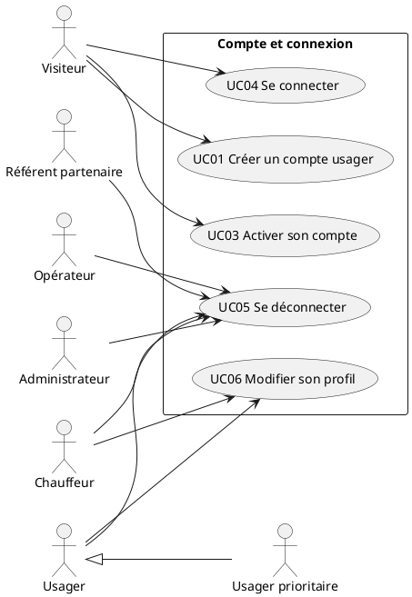
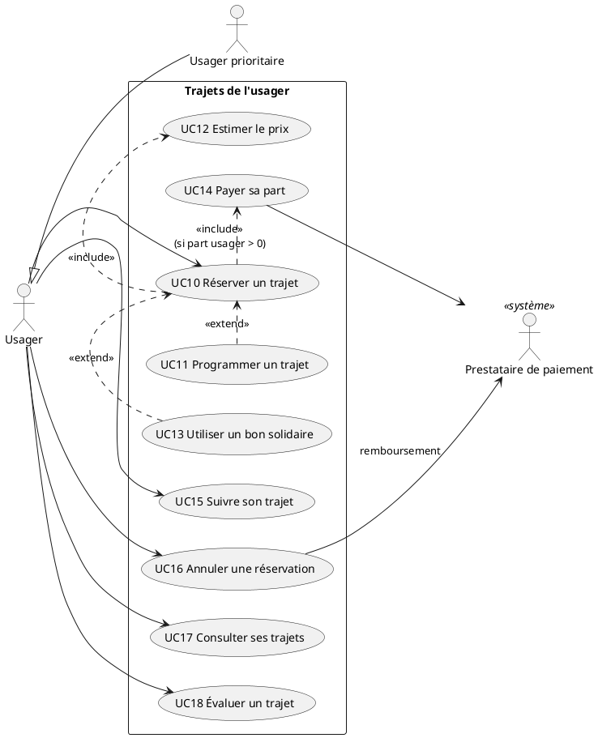
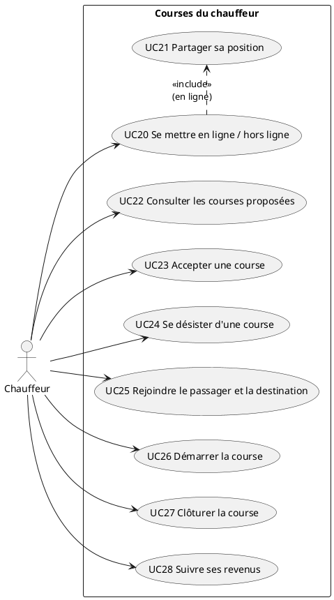
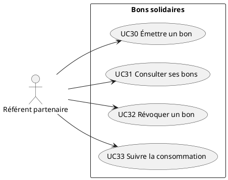
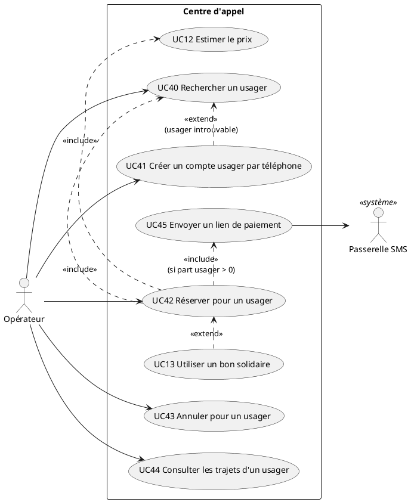
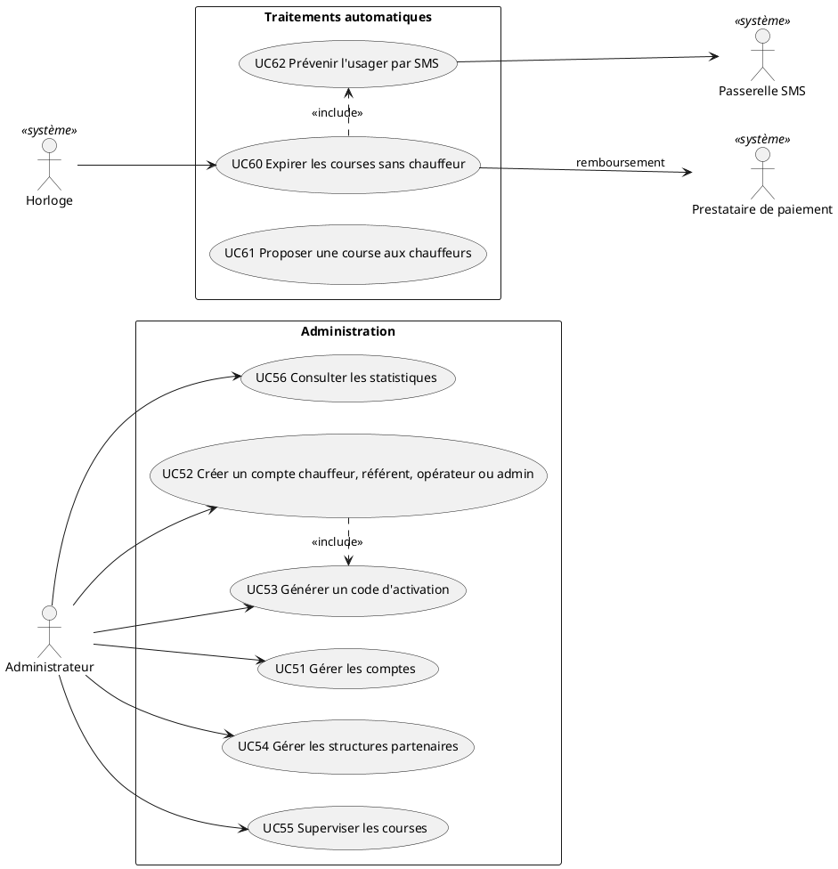

# Cas d'utilisation (version 1)

Ce document liste **tout ce que les utilisateurs doivent pouvoir faire** avec l'application, sous
forme de cas d'utilisation. Il sert de référence pour découper le développement en
fonctionnalités : chaque cas d'utilisation du MVP correspond à un écran (ou une partie d'écran)
côté front et à une ou plusieurs routes côté back.

Sources, par ordre de priorité :

1. [points-a-valider-porteur.pdf](points-a-valider-porteur.pdf) (13/10/2026) : ce que le client
   a **déjà confirmé**, et nos propositions en attente de réponse.
2. [compte-rendu-visio-1.md](compte-rendu-visio-1.md) : la première visio avec la cliente (zone
   du pilote, photo du chauffeur, abonnement).
3. [expression-des-besoins.pdf](expression-des-besoins.pdf) (06/07/2026) : le cahier des charges.
4. [contrat-api.md](contrat-api.md) (version 2) : les routes et les règles métier proposées.

Les réponses du client qui ont fait passer le contrat d'API de la version 1 à la version 2 sont
résumées en [partie 6](#6-écarts-avec-le-contrat-dapi-v1).

## Sommaire

1. [Acteurs](#1-acteurs)
2. [Vue d'ensemble](#2-vue-densemble)
3. [Liste des cas d'utilisation](#3-liste-des-cas-dutilisation)
4. [Fiches détaillées](#4-fiches-détaillées)
5. [Hors MVP et non classés](#5-hors-mvp-et-non-classés)
6. [Écarts avec le contrat d'API v1](#6-écarts-avec-le-contrat-dapi-v1)
7. [De la liste aux fonctionnalités](#7-de-la-liste-aux-fonctionnalités)

---

## 1. Acteurs

### Acteurs humains

| Acteur | Qui | Rôle dans l'API |
|---|---|---|
| **Visiteur** | Personne sans compte, ou non connectée | public |
| **Usager** | Réserve, paie, suit et évalue ses trajets | `rider` |
| **Usager prioritaire** | Un usager (personne en insertion, senior, PMR, demandeur d'emploi) marqué prioritaire. Hérite de tout ce que fait l'usager | `rider` + `isPriority` |
| **Chauffeur** | Chauffeur partenaire, éventuellement en parcours d'insertion | `driver` |
| **Référent partenaire** | Salarié d'une association, collectivité ou entreprise qui finance des trajets | `partner` |
| **Opérateur** | Personne dédiée du centre d'appel, qui réserve à la place de l'usager | `operator` |
| **Administrateur** | Équipe Ingeco qui pilote la plateforme | `admin` |

L'usager prioritaire est une **spécialisation** de l'usager : il n'a aucun cas d'utilisation
propre dans le MVP (hypothèse Q4 « aucun effet automatique »). Ce qui le distingue passe par les
bons solidaires et par le téléphone, ouverts à tous.

### Acteurs secondaires (systèmes)

| Acteur | Ce qu'il fait | Dans le MVP |
|---|---|---|
| **Horloge** | Déclenche les traitements périodiques (expiration des courses) | Tâche de l'API, chaque minute |
| **Prestataire de paiement** | Débite et rembourse la carte | **Simulé** (mode test) |
| **Passerelle SMS** | Envoie les SMS (lien de paiement, mode dégradé) | **Simulée** (écrit dans les logs, sans numéro ni contenu personnel) |
| **Service d'adresses** | Propose des adresses et calcule la distance par la route | Service externe sur données OpenStreetMap (H13) |

---

## 2. Vue d'ensemble

Les diagrammes sont en PlantUML : extension « PlantUML » de VS Code, ou
[plantuml.com](https://www.plantuml.com/plantuml) pour les afficher.

### 2.1 Compte et connexion

### 2.2 Usager

### 2.3 Chauffeur

### 2.4 Référent partenaire

### 2.5 Opérateur (centre d'appel)

### 2.6 Administrateur et système

---

## 3. Liste des cas d'utilisation

Colonne **Statut** : `MVP` (à développer), `Simulé` (développé, sans effet réel), `À trancher`
(dépend d'une réponse du client). Colonne **Étape** : l'étape de l'ordre de développement de
`CLAUDE.md`.

### Compte et connexion

| ID | Cas d'utilisation | Acteur principal | Statut | Étape | Routes |
|---|---|---|---|---|---|
| UC01 | Créer un compte usager | Visiteur | MVP | 2 | `POST /auth/register` |
| UC02 | ~~S'inscrire comme chauffeur~~ | – | Supprimé (19/10/2026) : remplacé par UC52 | – | – |
| UC03 | Activer son compte (premier accès ou mot de passe oublié) | Visiteur | MVP | 2 | `POST /auth/activate` |
| UC04 | Se connecter | Visiteur | MVP | 2 | `POST /auth/login`, `GET /auth/me`, `POST /auth/refresh` |
| UC05 | Se déconnecter | Tout connecté | MVP | 2 | `POST /auth/logout` |
| UC06 | Modifier son profil | Tout connecté | MVP | 2 | `PATCH /users/me` |

### Usager

| ID | Cas d'utilisation | Acteur principal | Statut | Étape | Routes |
|---|---|---|---|---|---|
| UC10 | Réserver un trajet immédiat | Usager | MVP | 3 | `GET /communes`, `GET /places`, `POST /rides` |
| UC11 | Programmer un trajet à l'avance | Usager | MVP | 3 | idem UC10, avec `scheduledAt` |
| UC12 | Estimer le prix d'un trajet | Usager, Opérateur | MVP | 3 | `POST /rides/estimate` |
| UC13 | Utiliser un bon solidaire | Usager, Opérateur | MVP | 5 | `POST /vouchers/check` |
| UC14 | Payer sa part | Usager | Simulé | 3 | `POST /rides/{id}/payment` |
| UC15 | Suivre son trajet sur une carte | Usager | MVP | 4 | `GET /rides/{id}`, `GET /rides/{id}/driver-photo`, événements `ride:updated`, `driver:location` |
| UC16 | Annuler une réservation | Usager | MVP | 3 | `POST /rides/{id}/cancel` |
| UC17 | Consulter ses trajets | Usager | MVP | 3 | `GET /rides`, `GET /rides/{id}` |
| UC18 | Évaluer un trajet | Usager | MVP | 3 | `POST /rides/{id}/rating` |

### Chauffeur

| ID | Cas d'utilisation | Acteur principal | Statut | Étape | Routes |
|---|---|---|---|---|---|
| UC20 | Se mettre en ligne / hors ligne | Chauffeur | MVP | 3 | `PUT /drivers/me/availability` |
| UC21 | Partager sa position | Chauffeur | MVP | 4 | `PUT /drivers/me/location` |
| UC22 | Consulter les courses proposées | Chauffeur | MVP | 3 (liste), 4 (temps réel) | `GET /drivers/me/ride-offers`, événement `ride:offer` |
| UC23 | Accepter une course | Chauffeur | MVP | 3 | `POST /rides/{id}/accept` |
| UC24 | Se désister d'une course | Chauffeur | MVP | 3 | `POST /rides/{id}/release` |
| UC25 | Rejoindre le passager et la destination | Chauffeur | MVP | 4 | Aucune (ouvre l'application GPS du téléphone) |
| UC26 | Démarrer la course | Chauffeur | MVP | 3 | `POST /rides/{id}/start` |
| UC27 | Clôturer la course | Chauffeur | MVP | 3 | `POST /rides/{id}/complete` |
| UC28 | Suivre ses revenus | Chauffeur | MVP | 3 | `GET /drivers/me/earnings` |

### Référent partenaire

| ID | Cas d'utilisation | Acteur principal | Statut | Étape | Routes |
|---|---|---|---|---|---|
| UC30 | Émettre un bon solidaire | Référent | MVP | 5 | `POST /vouchers` |
| UC31 | Consulter ses bons et les trajets financés | Référent | MVP | 5 | `GET /vouchers`, `GET /vouchers/{id}` |
| UC32 | Révoquer un bon | Référent | MVP | 5 | `POST /vouchers/{id}/revoke` |
| UC33 | Suivre la consommation de sa structure | Référent | MVP | 5 | `GET /partners/me/consumption` |

### Opérateur (centre d'appel)

| ID | Cas d'utilisation | Acteur principal | Statut | Étape | Routes |
|---|---|---|---|---|---|
| UC40 | Rechercher un usager | Opérateur | MVP | 6 | `GET /operator/riders` |
| UC41 | Créer un compte usager par téléphone | Opérateur | MVP | 6 | `POST /operator/riders` |
| UC42 | Réserver pour un usager | Opérateur | MVP | 6 | `POST /operator/rides` |
| UC43 | Annuler pour un usager | Opérateur | MVP | 6 | `POST /rides/{id}/cancel` |
| UC44 | Consulter les trajets d'un usager | Opérateur | À trancher (Q2) | 6 | `GET /operator/riders/{id}/rides` |
| UC45 | Envoyer un lien de paiement par SMS | Opérateur | Simulé, à trancher (Q1) | 6 | `POST /operator/rides/{id}/payment-link`, `GET` et `POST /payment-links/{token}` |

### Administrateur

| ID | Cas d'utilisation | Acteur principal | Statut | Étape | Routes |
|---|---|---|---|---|---|
| UC50 | ~~Valider l'inscription d'un chauffeur~~ | – | Supprimé (19/10/2026) : remplacé par UC52 | – | – |
| UC51 | Gérer les comptes (suspendre, réactiver, marquer prioritaire) | Administrateur | MVP | 2 | `GET /admin/users`, `PATCH /admin/users/{id}` |
| UC52 | Créer un compte chauffeur, référent, opérateur ou administrateur | Administrateur | MVP | 2 | `POST /admin/users`, `PUT /admin/users/{id}/photo` |
| UC53 | Générer un code d'activation | Administrateur | MVP | 2 | `POST /admin/users/{id}/activation-code` |
| UC54 | Gérer les structures partenaires | Administrateur | MVP | 5 | `GET`, `POST`, `PATCH /admin/partners` |
| UC55 | Superviser les courses (filtres, annulation, remboursements) | Administrateur | MVP | 7 | `GET /admin/rides`, `POST /rides/{id}/cancel` |
| UC56 | Consulter les statistiques | Administrateur | MVP | 7 | `GET /admin/stats` |

### Traitements automatiques

| ID | Cas d'utilisation | Acteur principal | Statut | Étape | Routes |
|---|---|---|---|---|---|
| UC60 | Expirer les courses restées sans chauffeur | Horloge | MVP | 3 | Tâche périodique |
| UC61 | Proposer une course aux chauffeurs proches | Système | MVP | 4 | Événements `ride:offer`, `ride:offer-closed` |
| UC62 | Prévenir l'usager par SMS (mode dégradé) | Système | Simulé | 4 | Aucune (logs) |

---

## 4. Fiches détaillées

Chaque fiche suit le même plan : déclencheur, préconditions, scénario nominal, variantes (A) et
erreurs (E), postconditions, règles. Les codes HTTP renvoient aux conventions du
[contrat d'API](contrat-api.md#1-conventions).

### Compte et connexion

#### UC01 Créer un compte usager

- **Acteur** : Visiteur
- **Déclencheur** : première ouverture de l'application.
- **Scénario nominal**
  1. Le visiteur choisit « Créer un compte ».
  2. Il saisit prénom, nom, numéro de téléphone, mot de passe, et en option son e-mail.
  3. Il indique s'il a besoin d'un véhicule accessible (fauteuil roulant).
  4. Le système crée un compte `rider` actif et le connecte.
- **Variantes et erreurs**
  - E1 : téléphone déjà utilisé (`409`). Si le compte a été créé par l'opérateur, le système
    explique qu'il faut l'activer (UC03) avec un code demandé au centre d'appel.
  - E2 : champ manquant ou mal formé (`400`), message en face du champ.
- **Postconditions** : un compte usager actif, non prioritaire.
- **Règles** : téléphone au format international (`+594…`), unique. Formulaire court, gros
  boutons, un seul écran si possible.

#### UC02 S'inscrire comme chauffeur (supprimé)

Décision du 19/10/2026 : le chauffeur ne s'inscrit pas dans l'application. Il apporte ses
documents (permis, assurance, carte VTC) en personne ; après vérification, un administrateur crée
son compte avec son véhicule (UC52), et le chauffeur l'active avec le code reçu (UC03).

#### UC03 Activer son compte

- **Acteur** : Visiteur dont le compte a été créé par un tiers, ou qui a oublié son mot de passe.
- **Préconditions** : un administrateur a généré un code (UC53) et le lui a transmis.
- **Scénario nominal**
  1. Le visiteur choisit « J'ai reçu un code ».
  2. Il saisit son téléphone, le code et son nouveau mot de passe.
  3. Le système vérifie le code, enregistre le mot de passe, efface le code et le connecte.
- **Erreurs** : E1 code faux ou expiré (48 h) : message unique, sans dire lequel des deux, pour
  ne rien révéler. E2 trop d'essais : blocage temporaire.
- **Postconditions** : compte utilisable avec un mot de passe.

#### UC04 Se connecter

- **Acteur** : Visiteur
- **Scénario nominal** : téléphone + mot de passe, puis le système ouvre l'accueil propre au rôle
  (réservation, courses, bons, administration).
- **Erreurs** : identifiants faux (`401`, message unique) ; compte suspendu (`403`, « Contactez le
  centre d'appel ») ; trop d'essais.

#### UC05 Se déconnecter

- **Acteur** : tout utilisateur connecté. Un chauffeur en ligne passe hors ligne (UC20).

#### UC06 Modifier son profil

- **Acteur** : tout utilisateur connecté.
- **Scénario nominal** : modifier nom, e-mail, mot de passe (avec l'ancien), besoin de véhicule
  accessible (usager).
- **Règles** : le téléphone ne se modifie pas en libre-service (c'est l'identifiant) : passer par
  l'administrateur. Le rôle et le statut prioritaire non plus.

### Usager

#### UC10 Réserver un trajet immédiat

- **Acteur** : Usager
- **Déclencheur** : l'usager a besoin de partir maintenant (emploi, formation, soins, démarche).
- **Préconditions** : connecté, compte actif, aucune réservation identique en cours d'envoi.
- **Scénario nominal**
  1. L'usager choisit la commune et l'adresse de départ (proposée à partir de sa position si
     elle est disponible), puis la commune et l'adresse d'arrivée.
  2. Il choisit le motif : emploi, formation, soins, démarche administrative, autre.
  3. Il saisit un code de bon s'il en a un (UC13).
  4. Le système affiche le prix total, la part du bon et la part à payer (UC12).
  5. L'usager confirme : le système enregistre la réservation (`awaiting_payment`).
  6. Si sa part est supérieure à zéro, il paie (UC14). Sinon le paiement est marqué « non
     requis » et l'étape est sautée.
  7. La course passe en `pending` et le système la propose aux chauffeurs proches (UC61).
  8. L'usager voit l'écran de suivi (UC15) : « Recherche d'un chauffeur ».
- **Variantes**
  - A1 : programmer plutôt que partir tout de suite : UC11.
  - A2 : réseau coupé pendant l'envoi : l'application renvoie la même demande (même
    `clientRequestId`) ; le système renvoie la course déjà créée sans la doubler.
- **Erreurs**
  - E1 : adresse introuvable : l'usager peut placer un point sur la carte ou choisir dans la
    liste.
  - E2 : bon refusé : UC13 E1 à E4, l'usager peut continuer sans bon.
  - E3 : paiement refusé : la course n'est pas proposée aux chauffeurs. L'usager peut réessayer
    pendant 15 minutes, après quoi la réservation expire et le bon est rendu (UC60).
  - E4 : aucun chauffeur en 15 minutes : UC60.
  - E5 : départ ou arrivée hors de la zone desservie (`422`) : le système le dit simplement
    (« Nous ne desservons pas encore cette adresse »). Que proposer d'autre : à voir avec la
    cliente.
- **Postconditions** : une course `pending`, payée ou sans part usager ; le bon utilisé compte
  une course de plus.
- **Règles** : le prix est **calculé par le serveur** et figé à la réservation (proposition B).
  Le prix affiché à l'étape 4 est recalculé à l'étape 5, jamais repris tel quel. Le besoin de
  véhicule accessible est copié du profil. Seules les communes desservies sont proposées : au
  départ Cayenne, Rémire-Montjoly et Matoury, demandé par la cliente en visio (H18 du contrat).

#### UC11 Programmer un trajet à l'avance

- **Acteur** : Usager
- **Déclencheur** : rendez-vous médical, entretien d'embauche, session de formation.
- **Scénario nominal** : comme UC10, avec en plus le choix de la date et de l'heure de prise en
  charge entre les étapes 2 et 3.
- **Erreurs** : E1 horaire à moins de 30 minutes : le système propose de réserver tout de suite.
  E2 bon non valable **le jour du trajet** (même s'il l'est aujourd'hui).
- **Postconditions** : course `pending` visible des chauffeurs dans « courses programmées ». Elle
  expire à l'heure prévue si personne ne l'a acceptée (UC60).

#### UC12 Estimer le prix d'un trajet

- **Acteurs** : Usager, Opérateur. Inclus dans UC10, UC11 et UC42.
- **Scénario nominal** : à partir des deux adresses (et du bon), le système calcule la distance
  par la route et renvoie prix total, part du bon, part de l'usager. Rien n'est enregistré.
- **Règles** : prise en charge + prix au kilomètre, tarif unique (propositions B et C). Montants
  en centimes. Part du bon arrondie au centime supérieur : l'arrondi n'est jamais à la charge de
  l'usager.

#### UC13 Utiliser un bon solidaire

- **Acteurs** : Usager, Opérateur. Étend UC10, UC11 et UC42.
- **Scénario nominal**
  1. L'usager (ou l'opérateur) saisit le code (`SOL-XXXXXXXX`).
  2. Le système vérifie le bon et affiche la structure qui finance et le pourcentage pris en
     charge.
  3. Le prix affiché est recalculé avec le bon.
- **Erreurs** (message simple, sans jargon) : E1 code inconnu ; E2 bon révoqué ou structure
  suspendue ; E3 bon épuisé ; E4 bon pas valable le jour du trajet ; E5 bon nominatif réservé à
  un autre usager ; E6 trop d'essais (protection contre les codes devinés).
- **Règles** : le bon est consommé **à la réservation** (dans la même transaction), et rendu si la
  course est annulée ou expire. Un désistement du chauffeur ne le touche pas.

#### UC14 Payer sa part (simulé)

- **Acteur** : Usager ; acteur secondaire : Prestataire de paiement.
- **Préconditions** : part usager > 0.
- **Scénario nominal** : l'usager suit les étapes d'un paiement par carte en mode test ; le
  système enregistre `paid` et la date.
- **Erreurs** : paiement refusé ou abandonné : l'usager peut réessayer ou abandonner la
  réservation.
- **Règles confirmées par le client** : **carte bancaire uniquement**, jamais d'espèces ; **paiement
  à la réservation, avant le trajet**. Un usager sans carte ne voyage qu'avec un bon à 100 % (Q9).

#### UC15 Suivre son trajet sur une carte

- **Acteur** : Usager
- **Scénario nominal**
  1. L'usager ouvre sa course en cours.
  2. Il voit l'état : recherche d'un chauffeur, chauffeur en route, à bord, terminé.
  3. Dès qu'un chauffeur accepte : sa photo, son prénom, son véhicule (modèle, immatriculation),
     sa note moyenne, et sa position sur la carte, mise à jour en direct.
- **Variantes** : A1 réseau faible : l'écran se met à jour à la reconnexion en relisant la
  course ; le mode dégradé par SMS prévient des étapes clés (UC62). A2 le chauffeur se désiste :
  retour à « Recherche d'un chauffeur », sans nouveau paiement.
- **Règles** : la position du chauffeur n'est visible que pendant une course active ; sa photo,
  tant que la course est acceptée ou en cours. La photo est demandée par la cliente pour la
  sécurité : le passager doit savoir qui vient le chercher. Elle s'affiche après le texte, en
  petite taille, pour ne pas ralentir l'écran sur réseau faible. Le reste du profil (« mini CV »)
  est à définir avec la cliente.

#### UC16 Annuler une réservation

- **Acteur** : Usager (Opérateur : UC43, Administrateur : UC55).
- **Préconditions** : course `pending` ou `accepted` (pas encore démarrée).
- **Scénario nominal** : l'usager demande l'annulation, confirme, le système annule, rend le bon,
  rembourse la part payée et prévient le chauffeur s'il y en avait un.
- **Erreurs** : course déjà démarrée ou terminée (`409`).
- **Règles** : remboursement intégral dans tous les cas (hypothèse Q7, à confirmer).

#### UC17 Consulter ses trajets

- **Acteur** : Usager
- **Scénario nominal** : liste de ses courses, les plus récentes d'abord, filtrable (à venir,
  passées). Détail d'une course : adresses, horaire, prix, part du bon, paiement, évaluation.

#### UC18 Évaluer un trajet

- **Acteur** : Usager
- **Préconditions** : course `completed`, pas encore évaluée.
- **Scénario nominal** : à la fin du trajet, l'application propose une note de 1 à 5 (étoiles,
  gros boutons) et un commentaire facultatif (500 caractères).
- **Variantes** : A1 l'usager passe : il pourra noter plus tard depuis UC17.
- **Erreurs** : déjà évaluée (`409`).
- **Règles** : satisfaction = part des notes de 4 ou 5 (proposition F, objectif client > 90 %).

### Chauffeur

#### UC20 Se mettre en ligne / hors ligne

- **Acteur** : Chauffeur
- **Préconditions** : compte activé, non suspendu.
- **Scénario nominal** : un seul gros bouton « Je suis disponible ». En ligne, le chauffeur
  partage sa position (UC21) et reçoit des propositions (UC22).
- **Règles** : hors ligne, sa position est effacée (RGPD). Il garde ses courses programmées
  acceptées.

#### UC21 Partager sa position

- **Acteur** : Chauffeur (automatique tant qu'il est en ligne).
- **Règles** : seule la dernière position est gardée, pas d'historique. Limite connue : en PWA,
  la position n'est plus envoyée si l'application passe en arrière-plan.

#### UC22 Consulter les courses proposées

- **Acteur** : Chauffeur
- **Scénario nominal**
  1. Onglet « Maintenant » : les courses immédiates en attente autour de lui, avec distance
     jusqu'au départ, communes, prix. Une nouvelle course apparaît en direct (UC61).
  2. Onglet « Programmées » : toutes les courses programmées en attente, par date.
- **Règles** : seules les courses compatibles avec son véhicule (accessible si demandé). Une
  course acceptée par un autre disparaît de la liste.

#### UC23 Accepter une course

- **Acteur** : Chauffeur
- **Scénario nominal** : il choisit une course, voit le détail, accepte. L'usager est prévenu
  (UC15).
- **Erreurs** : E1 course déjà prise par un autre chauffeur (`409`, « Course déjà prise ») ; E2 il
  a déjà une course active ou une course programmée à moins de 60 minutes (`409`) ; E3 course
  annulée ou expirée entre-temps.
- **Règles** : un seul gagnant si deux chauffeurs acceptent en même temps.

#### UC24 Se désister d'une course

- **Acteur** : Chauffeur
- **Préconditions** : course `accepted`, pas encore démarrée.
- **Scénario nominal** : le chauffeur se désiste et confirme ; la course redevient `pending` et
  est reproposée aux autres chauffeurs ; l'usager est prévenu, sans rien refaire ni repayer
  (proposition E).

#### UC25 Rejoindre le passager et la destination

- **Acteur** : Chauffeur
- **Scénario nominal** : depuis la course, un bouton « Itinéraire » ouvre l'application GPS du
  téléphone vers le point de départ, puis vers l'arrivée.
- **Règles** : pas de calcul d'itinéraire dans l'application (léger, économe en données). Le
  cahier des charges dit « naviguer » sans plus de précision : à confirmer avec le client.

#### UC26 Démarrer la course

- **Acteur** : Chauffeur
- **Préconditions** : course `accepted` dont il est le chauffeur.
- **Scénario nominal** : passager à bord, il appuie sur « Démarrer » ; l'usager voit « En route ».

#### UC27 Clôturer la course

- **Acteur** : Chauffeur
- **Préconditions** : course `in_progress`.
- **Scénario nominal** : arrivé, il appuie sur « Terminer » ; l'usager reçoit la demande
  d'évaluation (UC18) ; le chauffeur redevient disponible pour une nouvelle course.

#### UC28 Suivre ses revenus

- **Acteur** : Chauffeur
- **Scénario nominal** : il choisit une période (aujourd'hui, semaine, mois) et voit le total et
  le nombre de courses, par jour.
- **Règles** : prix total des courses terminées, sans commission (hypothèse Q8).

### Référent partenaire

#### UC30 Émettre un bon solidaire

- **Acteur** : Référent partenaire
- **Préconditions** : structure active.
- **Scénario nominal**
  1. Le référent choisit le pourcentage pris en charge (1 à 100 %), le nombre de trajets et la
     période de validité.
  2. En option, il le réserve à un usager précis (bon nominatif).
  3. Le système génère le code et l'affiche, prêt à être transmis à la personne.
- **Règles** : un pourcentage sur un nombre de trajets (hypothèse Q5) ; nominatif ou libre
  (hypothèse Q6). Comment le référent désigne le bénéficiaire d'un bon nominatif (par son
  téléphone ?) reste à préciser.

#### UC31 Consulter ses bons et les trajets financés

- **Acteur** : Référent partenaire
- **Scénario nominal** : liste des bons de sa structure (actifs, épuisés, expirés, révoqués),
  avec trajets utilisés sur trajets prévus. Détail d'un bon : pour chaque trajet financé, la
  date, les communes, le statut et le montant pris en charge.
- **Règles** : jamais le nom du passager, ni les adresses, ni le motif (hypothèse Q12, RGPD).

#### UC32 Révoquer un bon

- **Acteur** : Référent partenaire
- **Scénario nominal** : il révoque un bon (perdu, mal utilisé) ; le code n'est plus accepté.
- **Règles** : les trajets déjà réservés restent financés.

#### UC33 Suivre la consommation de sa structure

- **Acteur** : Référent partenaire
- **Scénario nominal** : sur une période, bons émis, trajets financés, montant pris en charge,
  par mois et par motif.
- **Règles** : totaux de sa structure seulement, sans donnée individuelle.

### Opérateur (centre d'appel)

#### UC40 Rechercher un usager

- **Acteur** : Opérateur
- **Scénario nominal** : pendant l'appel, il tape le début du numéro ou le nom ; le système
  propose les usagers correspondants.
- **Variantes** : A1 aucun résultat : UC41.

#### UC41 Créer un compte usager par téléphone

- **Acteur** : Opérateur
- **Scénario nominal** : il saisit prénom, nom, téléphone, besoin de véhicule accessible. Le
  compte est créé sans mot de passe : l'usager peut ne jamais utiliser l'application.
- **Variantes** : A1 l'usager veut l'application plus tard : un administrateur génère un code
  d'activation (UC53).
- **Erreurs** : téléphone déjà utilisé : l'opérateur retrouve le compte existant (UC40).

#### UC42 Réserver pour un usager

- **Acteur** : Opérateur
- **Déclencheur** : un usager appelle (tout usager, pas seulement les prioritaires : confirmé par
  le client).
- **Scénario nominal**
  1. L'opérateur retrouve ou crée l'usager (UC40, UC41).
  2. Il saisit départ, arrivée, motif, et l'horaire si le trajet est programmé.
  3. Il saisit le code de bon que l'usager lui dicte (UC13).
  4. Il annonce le prix et la part à payer (UC12) ; l'usager accepte.
  5. Si la part usager est supérieure à zéro, le système envoie un lien de paiement par SMS
     (UC45) ; l'usager paie sur son téléphone.
  6. La course est enregistrée avec le canal « téléphone » et le nom de l'opérateur qui l'a
     saisie, puis proposée aux chauffeurs.
- **Erreurs** : comme UC10.
- **Règles** : l'opérateur ne voit ni ne saisit jamais de numéro de carte.

#### UC43 Annuler pour un usager

- **Acteur** : Opérateur. Mêmes règles que UC16.

#### UC44 Consulter les trajets d'un usager (à trancher)

- **Acteur** : Opérateur
- **Scénario** : pendant l'appel, voir les courses à venir et passées de l'usager pour répondre à
  « mon chauffeur arrive quand ? ». Pas dans l'hypothèse Q2 (« créer un compte, réserver,
  annuler ») : à confirmer. Sans lui, l'opérateur ne peut pas retrouver la course à annuler
  (UC43) : nous recommandons de l'inclure, au moins pour les courses à venir.

#### UC45 Envoyer un lien de paiement par SMS (simulé, à trancher)

- **Acteur** : Opérateur ; acteurs secondaires : Passerelle SMS, Prestataire de paiement.
- **Scénario** : le système envoie à l'usager un lien de paiement à usage unique ; l'usager paie
  sur son téléphone ; la course est payée. Dans le MVP, le SMS est écrit dans les logs et le lien
  ouvre la page de paiement simulé.
- **Question** : un usager sans smartphone ne peut pas ouvrir le lien. Reste le bon à 100 %
  (Q9).

### Administrateur

#### UC50 Valider l'inscription d'un chauffeur (supprimé)

Remplacé par la création du compte chauffeur par l'administrateur (UC52), voir UC02.

#### UC51 Gérer les comptes

- **Acteur** : Administrateur
- **Scénario nominal** : rechercher un compte par nom ou téléphone, filtrer par rôle et statut ;
  suspendre, réactiver, marquer un usager prioritaire (hypothèse Q3).
- **Règles** : pas de suppression physique ; un compte suspendu ne peut plus se connecter.

#### UC52 Créer un compte chauffeur, référent, opérateur ou administrateur

- **Acteur** : Administrateur
- **Scénario nominal** : il saisit l'identité et le téléphone, choisit le rôle (avec le véhicule
  pour un chauffeur, dont il a vérifié les documents en personne, et la structure pour un
  référent) ; le compte est créé sans mot de passe et le système génère le code
  d'activation (UC53). Pour un chauffeur, il ajoute sa photo, prise lors du rendez-vous.
- **Règles** : à ce rendez-vous, la société vérifie le permis, l'âge et le véhicule (visio avec
  la cliente), en plus de l'assurance et de la carte VTC.

#### UC53 Générer un code d'activation

- **Acteur** : Administrateur
- **Scénario nominal** : pour un premier accès ou un mot de passe oublié, il génère un code ;
  le code est affiché **une seule fois**, il le transmet par téléphone ou en main propre.
- **Règles** : valable 48 h, remplace le précédent.

#### UC54 Gérer les structures partenaires

- **Acteur** : Administrateur
- **Scénario nominal** : créer une structure (nom, type : association, collectivité,
  entreprise), la renommer, la suspendre ou la réactiver.
- **Règles** : les bons d'une structure suspendue ne sont plus acceptés pour de nouvelles
  réservations.

#### UC55 Superviser les courses

- **Acteur** : Administrateur
- **Scénario nominal** : liste de toutes les courses, filtrable par statut, date, commune, état du
  paiement ; détail d'une course ; annulation (UC16).
- **Règles** : le paiement se fait avant le trajet, il n'y a donc pas d'impayé à suivre (voir
  [partie 6](#6-écarts-avec-le-contrat-dapi-v1)).

#### UC56 Consulter les statistiques

- **Acteur** : Administrateur
- **Scénario nominal** : sur une période, le tableau de bord affiche au minimum (hypothèse Q15) :
  trajets par jour, par commune et par motif ; trajets financés et montants pris en charge, au
  total et par structure ; note moyenne et taux de satisfaction.
- **Compléments proposés** : trajets par canal (application, téléphone), courses expirées (la
  demande non servie), usagers et chauffeurs actifs, part des usagers prioritaires.

### Traitements automatiques

#### UC60 Expirer les courses restées sans chauffeur

- **Acteur** : Horloge (chaque minute).
- **Scénario nominal** : toute course `pending` (sans chauffeur) ou `awaiting_payment` (pas
  payée en 15 minutes) dont l'échéance est passée devient `expired` ; le bon est rendu, la part
  payée est **remboursée**, l'usager est prévenu (UC62) et peut relancer sa demande.
- **Règles** : échéance = 15 minutes après la réservation pour une course immédiate, l'heure
  prévue pour une course programmée (proposition D).

#### UC61 Proposer une course aux chauffeurs proches

- **Acteur** : Système
- **Scénario nominal** : à la réservation d'une course immédiate (ou après un désistement), le
  système l'envoie en direct aux chauffeurs en ligne, proches, sans course active, avec un
  véhicule compatible. Quand elle est prise, annulée ou expirée, elle disparaît de leur écran.
- **Règles** : le temps réel accélère l'affichage, il n'est jamais la seule source : à la
  reconnexion, l'application relit l'état.

#### UC62 Prévenir l'usager par SMS (simulé)

- **Acteur** : Système ; acteur secondaire : Passerelle SMS.
- **Déclencheurs** : chauffeur trouvé, chauffeur arrivé ou désisté, course expirée, lien de
  paiement.
- **Règles** : dans le MVP, une ligne de log par SMS, **sans numéro ni contenu personnel**. Quels
  messages exactement : à fixer avec le client (question 4 du contrat d'API).

---

## 5. Hors MVP et non classés

À ne pas développer sans demande explicite du client. Les identifiants sont réservés pour la
suite.

| ID | Cas d'utilisation | Acteur | Pourquoi pas dans le MVP |
|---|---|---|---|
| UC70 | Paramétrer les tarifs | Administrateur | Tarif fixe suffisant pour le pilote (Q10) |
| UC71 | Appliquer un tarif selon le profil ou le financement | Système | Proposition C : la solidarité passe par les bons |
| UC72 | Déposer et vérifier les documents d'un chauffeur | Chauffeur, Administrateur | Vérifiés hors application (Q11) |
| UC73 | Recevoir des notifications (hors SMS) | Usager | Reporté |
| UC74 | Consulter les indicateurs d'impact social et la couverture territoriale | Administrateur, Référent | Le tableau de bord commence par les chiffres de Q15 |
| UC75 | Recevoir une facturation consolidée | Référent | Dépend du fonctionnement des bons (Q5, Q6) |
| UC76 | Suivre le module de formation | Chauffeur | Contenu à écrire avec le client |
| UC77 | Évaluer l'usager | Chauffeur | Non demandé |
| UC78 | Gérer un planning de disponibilités | Chauffeur | En ligne / hors ligne suffit (H4) |
| UC79 | Souscrire un abonnement mensuel (nombre de courses ou montant) | Usager | Évoqué par la cliente en visio, absent du cahier des charges : non classé |
| UC80 | Enregistrer l'agrément d'un chauffeur pour le transport de personnes handicapées | Administrateur | « En deuxième partie », selon la cliente |
| UC81 | Desservir Kourou et d'autres communes | Administrateur, équipe BD | Le pilote commence par Cayenne et ses environs ; ajouter une commune est une donnée de référence |
| – | Payer en espèces | Usager | **Exclu** par le cahier des charges et confirmé par le client |

---

## 6. Écarts avec le contrat d'API v1

Les réponses du client du 13/10/2026 changeaient trois points du contrat d'API v1. Ils sont
**intégrés dans la version 2** du [contrat d'API](contrat-api.md#ce-qui-change-depuis-la-version-1),
à transmettre à l'équipe BD (les points 1 et 2 touchent le schéma).

| # | Sujet | Contrat v1 | Ce que le client a confirmé | Dans le contrat v2 |
|---|---|---|---|---|
| 1 | Moment du paiement | Paiement à partir de `accepted`, possible après la course, impayés suivis | **Paiement à la réservation, avant le trajet** | Statut `awaiting_payment` avant `pending` : la course n'est proposée aux chauffeurs qu'une fois payée. Plus d'impayé. L'expiration (UC60) rembourse |
| 2 | Qui tient le centre d'appel | L'administrateur (H3) | **Des personnes dédiées** | Rôle `operator`, sans droits d'administration |
| 3 | Paiement par téléphone | L'opérateur enregistre le paiement | Hypothèse Q1 : **lien de paiement par SMS** | Lien signé (UC45), rien à stocker en base |

UC44 (trajets d'un usager vus par l'opérateur) a aussi sa route dans la version 2, en attente de
la réponse du client (Q2).

Sur les quatre points donnés comme confirmés le 13/10/2026, deux ont été dits pendant la première
visio (carte uniquement, paiement à la réservation). Les deux autres (réservation par téléphone
pour tous, appels pris par des personnes dédiées) n'y figurent pas : retrouver la trace écrite de
cette réponse.

La première visio ajoute aussi au contrat v2 la zone du pilote (H18) et la photo du chauffeur
(H19), voir [compte-rendu-visio-1.md](compte-rendu-visio-1.md).

---

## 7. De la liste aux fonctionnalités

Regroupement des cas d'utilisation MVP par étape de développement, pour en faire des branches
`feature/...`.

| Étape | Fonctionnalité | Cas d'utilisation | Écrans principaux |
|---|---|---|---|
| 2 | Inscription, connexion, activation | UC01, UC03 à UC06 | Accueil, inscription usager, activation, connexion, profil |
| 2 | Administration des comptes | UC51 à UC53 | Liste des comptes, fiche compte, création de compte (dont chauffeur et véhicule) |
| 3 | Réservation et paiement | UC10, UC11, UC12, UC14 | Réserver (adresses, motif, horaire, prix, confirmation), paiement simulé |
| 3 | Mes trajets, annulation, évaluation | UC16, UC17, UC18 | Liste et détail des trajets, évaluation |
| 3 | Courses du chauffeur | UC20, UC22 (liste), UC23, UC24, UC26, UC27, UC28 | Disponibilité, courses proposées, course en cours, revenus |
| 3 | Expiration des courses | UC60 | Aucun (tâche) |
| 4 | Temps réel et carte | UC15, UC21, UC22 (direct), UC25, UC61, UC62 | Suivi sur carte (usager), carte de la course (chauffeur) |
| 5 | Bons solidaires | UC13, UC30 à UC33, UC54 | Saisie du code à la réservation, bons du référent, consommation, structures (admin) |
| 6 | Écran opérateur | UC40 à UC45 | Recherche d'usager, création, réservation pour un tiers |
| 7 | Supervision et statistiques | UC55, UC56 | Liste des courses, tableau de bord |
